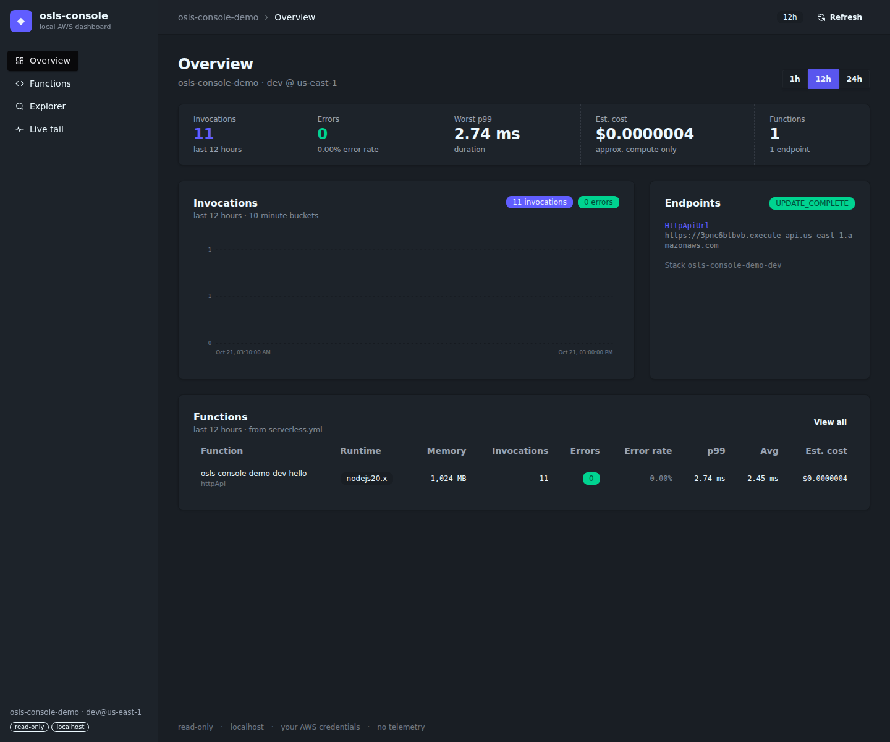
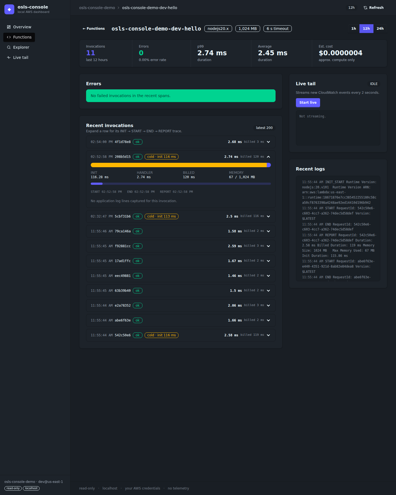
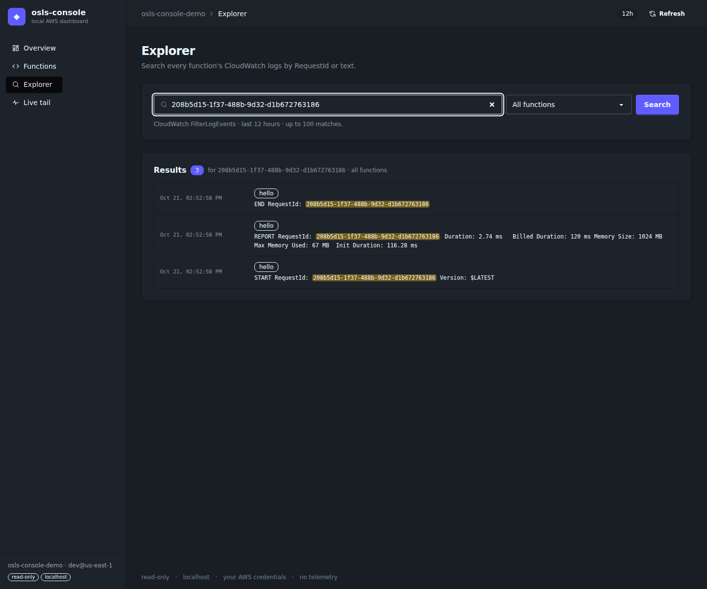

# osls-console

A local, read-only dashboard for your Serverless Framework / osls service.

osls-console is a local, read-only dashboard for [osls](https://github.com/oss-serverless/osls) and Serverless Framework services (v3 and v4). It serves a daisyUI dashboard on localhost and reads CloudWatch directly with your own AWS credentials. There is no login, no hosted service, no telemetry, and nothing is added to your deploy. It works as an osls plugin and as a standalone CLI.



## Installation

From a Serverless Framework / osls project:

```bash
npm i -D osls-console
npx osls-console
```

The published package includes the compiled CSS. There is no build step for the user, no CDN, and no hosted dependency.

## Usage

### CLI

```bash
npx osls-console
npx osls-console --port 4000 --profile my-aws-profile
npx osls-console --cwd ../my-service --stage prod
```

| Flag | Meaning |
|---|---|
| `--cwd` | Project directory (default: current directory) |
| `--port` | Port (default: `3124`) |
| `--host` | Bind address (default: `127.0.0.1`; use `0.0.0.0` for LAN access) |
| `--stage` | Stage override (default: `provider.stage` or `dev`) |
| `--profile` | AWS profile (sets `AWS_PROFILE`) |
| `--price-gb-second` | Lambda compute price in USD per GB-second (default: us-east-1, `0.0000166667`) |

### Plugin

```yaml
# serverless.yml
plugins:
  - osls-console
```

```bash
osls console            # or: serverless console
osls console --port 4000
```

### AWS access

The standard credential chain is used (`AWS_PROFILE`, SSO, instance roles, or `--profile`). The dashboard only needs read permissions:

```text
cloudwatch:GetMetricData
logs:DescribeLogStreams
logs:GetLogEvents
logs:FilterLogEvents
cloudformation:DescribeStacks
```

## Features

| Area | Hosted dashboard | osls-console |
|---|---|---|
| Services list | Org-wide hosted view | Per-service view; the org view is a hosted concept and stays out of scope |
| Metrics | Invocations, errors, duration, cost | Invocations, errors, error rate, p99, average and estimated cost with 1h / 12h / 24h windows |
| Traces | Invocation traces | Per-invocation INIT → START → HANDLER → END → REPORT timeline with durations, billed time and memory |
| Invocation Explorer | Per-function search | Cross-function search by RequestId or text across every log group in the service |
| Live tail | Hosted streaming | SSE live tail per function and across all functions, polled every 2 seconds |
| Troubleshoot | Errors, timeouts, OOM | Errors panel filters failed spans and shows the root-cause log line; overview and table show error rate |
| Outputs / endpoints | CloudFormation outputs | Same, read from the deployed stack |
| CI/CD, Alerts, Providers | Hosted account features | Not ported: they belong to a hosted account model and contradict the local-first design |

### Function detail



### Explorer



## Scope and differences

osls-console is deliberately smaller than a hosted dashboard:

- **Data path:** the browser talks to a local server, and that server calls CloudWatch and CloudFormation with your IAM identity. Nothing leaves your machine except those AWS API calls.
- **No account layer:** no login, organizations, teams, RBAC or shared state. It is a single-user tool bound to localhost by default.
- **No deployment control:** it does not deploy, invoke or mutate functions. It is read-only.
- **No hosted features:** CI/CD, alerts, provider connections and deployment history are intentionally absent.
- **Approximate cost:** the estimate uses Lambda on-demand compute pricing (`billed ms × GB × price`) with the memory configured in `serverless.yml`. It excludes request charges, free tier, provisioned concurrency and ephemeral storage, and should be treated as an order-of-magnitude signal.

## Verified

Checked on 2026-10-21 against the deployed `osls-console-demo-dev` stack in `us-east-1`:

- `GET /api/service?window=12h`: 11 invocations, 0 errors, p99 2.74 ms, estimated compute cost `$0.00000038`.
- `GET /api/lambda/osls-console-demo-dev-hello`: 11 spans; a cold invocation reports `Init Duration: 115.86 ms` separately from `Duration: 2.58 ms`.
- SSE: a real HTTP hit to the demo produced new START, END and REPORT lines in the stream without a page reload (CloudWatch ingestion delay included).
- Explorer: a real RequestId was found in its START, END and REPORT lines across the service log group.
- Errors: the clean demo shows a healthy state; fixtures for `Status: error`, `Task timed out` and an out-of-memory kill are detected by the parser tests.
- `npm test`: 24 tests pass. `npm run smoke` against the live demo passes.
- Toolchain: Tailwind CSS `4.3.3` + daisyUI `5.7.50`; compiled CSS is committed and served locally with no CDN.
- Plugin contract: loads and serves the dashboard on osls `4.4.0` and osls `3.78.0`.

## License

MIT — see [LICENSE](LICENSE).
